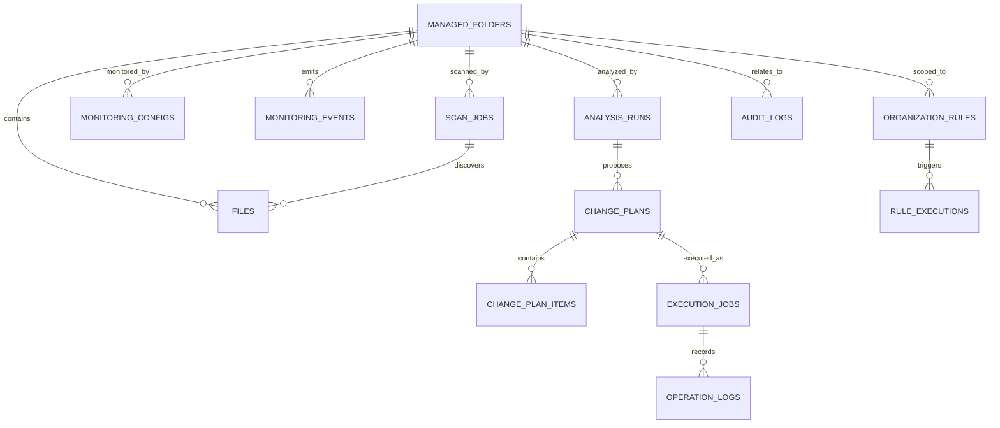

# Database Design — Desktop & Storage Manager

> Status: Initial logical design  
> Database: SQLite  
> ORM: SQLAlchemy  
> Migrations: Alembic  
> Authority: This document defines the intended data model. ORM models and Alembic migrations must implement it; do not invent parallel schemas.

## 1. Goals and boundaries

The database stores application metadata, scan results, analysis output, proposed changes, approvals, execution history, monitoring configuration, and application settings.

It does **not** store the user's file contents. Files remain on their original disks. The `files` table stores metadata and a path relative to a registered Managed Folder.

Only folders explicitly registered by the user are in scope. Registering a folder must not trigger a scan automatically.

## 2. Naming and data conventions

- Table and column names: `snake_case`, plural table names.
- Primary keys: UUID strings (`TEXT`), generated by the application.
- Timestamps: UTC ISO-8601 strings (`TEXT`).
- Booleans: SQLite `INTEGER` constrained to `0` or `1`.
- Sizes: integer bytes (`INTEGER`).
- Paths: store canonical absolute path only for a Managed Folder root. For files, store a relative path from that root.
- JSON: `TEXT` containing validated JSON. Use it only for variable structured payloads, not for core relational fields.
- Every mutable entity has `created_at` and `updated_at` where applicable.
- Use foreign keys and enable `PRAGMA foreign_keys = ON` for every connection.
- Use soft status fields for operational records; do not physically delete audit history.

## 3. Entity relationship overview



`MANAGED_FOLDERS` is the root scope for file access. A file record is valid only when its `managed_folder_id` references a registered root.

## 4. Tables

### 4.1 `managed_folders`

One row per folder explicitly registered by the user.

| Column | Type | Rules |
|---|---|---|
| `id` | TEXT | PK UUID |
| `name` | TEXT | Required display name |
| `root_path` | TEXT | Required canonical absolute path; unique |
| `is_enabled` | INTEGER | NOT NULL DEFAULT 1, boolean |
| `monitoring_enabled` | INTEGER | NOT NULL DEFAULT 0, boolean |
| `scan_on_startup` | INTEGER | NOT NULL DEFAULT 0, boolean; opt-in only |
| `exclude_patterns_json` | TEXT | NOT NULL DEFAULT `[]` |
| `last_scanned_at` | TEXT | Nullable UTC timestamp |
| `created_at` | TEXT | Required UTC timestamp |
| `updated_at` | TEXT | Required UTC timestamp |

Constraints: `UNIQUE(root_path)`, boolean checks. A disabled folder cannot be used for new scans or mutations.

### 4.2 `scan_jobs`

Tracks manual and scheduled metadata scans.

| Column | Type | Rules |
|---|---|---|
| `id` | TEXT | PK UUID |
| `managed_folder_id` | TEXT | FK → `managed_folders.id`, required |
| `scan_type` | TEXT | `metadata` or `deep` |
| `status` | TEXT | `queued`, `running`, `completed`, `failed`, `cancelled` |
| `files_seen` | INTEGER | NOT NULL DEFAULT 0 |
| `folders_seen` | INTEGER | NOT NULL DEFAULT 0 |
| `bytes_seen` | INTEGER | NOT NULL DEFAULT 0 |
| `error_message` | TEXT | Nullable |
| `started_at` | TEXT | Nullable |
| `finished_at` | TEXT | Nullable |
| `created_at` | TEXT | Required |

A scan job records progress and outcome. It does not grant permission to access paths outside its Managed Folder.

### 4.3 `files`

Latest known metadata for each file or directory within a Managed Folder.

| Column | Type | Rules |
|---|---|---|
| `id` | TEXT | PK UUID |
| `managed_folder_id` | TEXT | FK → `managed_folders.id`, required |
| `last_seen_scan_id` | TEXT | FK → `scan_jobs.id`, nullable |
| `relative_path` | TEXT | Required path relative to root |
| `parent_relative_path` | TEXT | Nullable; root-level entries use empty string |
| `name` | TEXT | Required |
| `extension` | TEXT | Nullable, normalized lowercase without leading dot |
| `item_type` | TEXT | `file` or `directory` |
| `size_bytes` | INTEGER | NOT NULL DEFAULT 0 |
| `modified_at` | TEXT | Nullable filesystem timestamp |
| `created_fs_at` | TEXT | Nullable filesystem timestamp |
| `content_hash` | TEXT | Nullable; populated only when hashing is requested |
| `hash_algorithm` | TEXT | Nullable, e.g. `sha256` |
| `mime_type` | TEXT | Nullable |
| `is_hidden` | INTEGER | NOT NULL DEFAULT 0 |
| `is_deleted` | INTEGER | NOT NULL DEFAULT 0; means no longer observed, not physically deleted |
| `last_scanned_at` | TEXT | Nullable |
| `created_at` | TEXT | Required |
| `updated_at` | TEXT | Required |

Constraints: `UNIQUE(managed_folder_id, relative_path)`, boolean checks, non-negative `size_bytes`. Do not store a second absolute path for every file. Resolve paths from the validated root plus `relative_path`.

### 4.4 `analysis_runs`

Stores analysis requests and their structured results.

| Column | Type | Rules |
|---|---|---|
| `id` | TEXT | PK UUID |
| `managed_folder_id` | TEXT | FK → `managed_folders.id`, required |
| `scan_job_id` | TEXT | FK → `scan_jobs.id`, nullable |
| `analysis_type` | TEXT | e.g. `storage`, `duplicates`, `organization`, `rename` |
| `engine` | TEXT | `local` or `ai` |
| `status` | TEXT | `queued`, `running`, `completed`, `failed`, `cancelled` |
| `result_json` | TEXT | Nullable validated JSON |
| `error_message` | TEXT | Nullable |
| `started_at` | TEXT | Nullable |
| `finished_at` | TEXT | Nullable |
| `created_at` | TEXT | Required |

Do not store raw document contents or credentials in `result_json`.

### 4.5 `change_plans`

A proposed set of filesystem changes. A plan is not an execution.

| Column | Type | Rules |
|---|---|---|
| `id` | TEXT | PK UUID |
| `managed_folder_id` | TEXT | FK → `managed_folders.id`, required |
| `analysis_run_id` | TEXT | FK → `analysis_runs.id`, nullable |
| `title` | TEXT | Required |
| `plan_type` | TEXT | `organize`, `rename`, `manual` |
| `status` | TEXT | `draft`, `pending_review`, `approved`, `rejected`, `executing`, `completed`, `failed`, `cancelled`, `stale` |
| `created_by` | TEXT | `user` or `ai` |
| `approved_at` | TEXT | Nullable |
| `approved_by` | TEXT | Nullable user identifier |
| `created_at` | TEXT | Required |
| `updated_at` | TEXT | Required |

Approval must be explicit and separate from plan generation.

### 4.6 `change_plan_items`

One row per proposed filesystem operation.

| Column | Type | Rules |
|---|---|---|
| `id` | TEXT | PK UUID |
| `change_plan_id` | TEXT | FK → `change_plans.id`, required |
| `operation` | TEXT | `create_directory`, `rename`, `move`, `copy`, `delete_to_recycle_bin` |
| `source_relative_path` | TEXT | Nullable for create operations |
| `destination_relative_path` | TEXT | Nullable only when not applicable |
| `expected_size_bytes` | INTEGER | Nullable |
| `expected_modified_at` | TEXT | Nullable |
| `expected_hash` | TEXT | Nullable |
| `status` | TEXT | `pending`, `approved`, `executing`, `completed`, `failed`, `skipped`, `conflict` |
| `conflict_reason` | TEXT | Nullable |
| `sequence_no` | INTEGER | Required; execution order |
| `created_at` | TEXT | Required |

Before execution, revalidate the root, source, destination, collisions, and expected source state. Never silently overwrite.

### 4.7 `execution_jobs`

Tracks execution of an approved plan.

| Column | Type | Rules |
|---|---|---|
| `id` | TEXT | PK UUID |
| `change_plan_id` | TEXT | FK → `change_plans.id`, required |
| `status` | TEXT | `queued`, `running`, `completed`, `failed`, `partial`, `rolled_back`, `cancelled` |
| `started_at` | TEXT | Nullable |
| `finished_at` | TEXT | Nullable |
| `error_message` | TEXT | Nullable |
| `created_at` | TEXT | Required |

One plan may have multiple execution attempts only if the application explicitly supports safe retry semantics. Each attempt must remain auditable.

### 4.8 `operation_logs`

Append-only operation-level results and rollback references.

| Column | Type | Rules |
|---|---|---|
| `id` | TEXT | PK UUID |
| `execution_job_id` | TEXT | FK → `execution_jobs.id`, required |
| `change_plan_item_id` | TEXT | FK → `change_plan_items.id`, required |
| `operation` | TEXT | Required |
| `source_path_snapshot` | TEXT | Nullable; redact if needed |
| `destination_path_snapshot` | TEXT | Nullable; redact if needed |
| `status` | TEXT | `started`, `completed`, `failed`, `rollback_completed`, `rollback_failed` |
| `backup_reference` | TEXT | Nullable internal recovery reference |
| `error_message` | TEXT | Nullable |
| `started_at` | TEXT | Required |
| `finished_at` | TEXT | Nullable |

Never store file contents in logs. Logs should be append-only from the application perspective.

### 4.9 `monitoring_configs`

Watcher configuration per Managed Folder.

| Column | Type | Rules |
|---|---|---|
| `id` | TEXT | PK UUID |
| `managed_folder_id` | TEXT | FK → `managed_folders.id`, UNIQUE, required |
| `is_enabled` | INTEGER | NOT NULL DEFAULT 0 |
| `recursive` | INTEGER | NOT NULL DEFAULT 1 |
| `debounce_ms` | INTEGER | NOT NULL DEFAULT 1000 |
| `ignore_patterns_json` | TEXT | NOT NULL DEFAULT `[]` |
| `created_at` | TEXT | Required |
| `updated_at` | TEXT | Required |

### 4.10 `monitoring_events`

Normalized filesystem events received from Watchdog.

| Column | Type | Rules |
|---|---|---|
| `id` | TEXT | PK UUID |
| `managed_folder_id` | TEXT | FK → `managed_folders.id`, required |
| `event_type` | TEXT | `created`, `modified`, `deleted`, `moved` |
| `relative_path` | TEXT | Required |
| `destination_relative_path` | TEXT | Nullable for move destination |
| `event_key` | TEXT | Required deduplication key |
| `status` | TEXT | `pending`, `processed`, `ignored`, `failed` |
| `occurred_at` | TEXT | Required |
| `processed_at` | TEXT | Nullable |

Add a unique or time-window deduplication strategy for `event_key`. Monitoring events do not directly execute file mutations.

### 4.11 `organization_rules`

User-approved rules for narrowly scoped automation.

| Column | Type | Rules |
|---|---|---|
| `id` | TEXT | PK UUID |
| `managed_folder_id` | TEXT | FK → `managed_folders.id`, required |
| `name` | TEXT | Required |
| `rule_type` | TEXT | `organize` or `rename` |
| `scope_json` | TEXT | Required validated scope definition |
| `conditions_json` | TEXT | Required validated conditions |
| `actions_json` | TEXT | Required validated actions |
| `is_enabled` | INTEGER | NOT NULL DEFAULT 0 |
| `approved_at` | TEXT | Nullable |
| `approved_by` | TEXT | Nullable |
| `version` | INTEGER | NOT NULL DEFAULT 1 |
| `created_at` | TEXT | Required |
| `updated_at` | TEXT | Required |

Rules must not run unless explicitly approved, enabled, and still within the exact approved scope/version.

### 4.12 `rule_executions`

Execution history for approved rules.

| Column | Type | Rules |
|---|---|---|
| `id` | TEXT | PK UUID |
| `organization_rule_id` | TEXT | FK → `organization_rules.id`, required |
| `monitoring_event_id` | TEXT | FK → `monitoring_events.id`, nullable |
| `execution_job_id` | TEXT | FK → `execution_jobs.id`, nullable |
| `rule_version` | INTEGER | Required snapshot |
| `status` | TEXT | `skipped`, `pending_review`, `executed`, `failed` |
| `reason` | TEXT | Nullable |
| `created_at` | TEXT | Required |

### 4.13 `audit_logs`

Application-level audit trail for important user and system actions.

| Column | Type | Rules |
|---|---|---|
| `id` | TEXT | PK UUID |
| `actor_type` | TEXT | `user`, `system`, `ai` |
| `action` | TEXT | Required action key |
| `entity_type` | TEXT | Required entity name |
| `entity_id` | TEXT | Nullable |
| `details_json` | TEXT | Nullable validated JSON |
| `created_at` | TEXT | Required |

Do not put credentials, API keys, document contents, or other secrets in audit details.

### 4.14 `app_settings`

Non-secret application settings.

| Column | Type | Rules |
|---|---|---|
| `key` | TEXT | PK |
| `value_json` | TEXT | Required validated JSON |
| `updated_at` | TEXT | Required |

Secrets such as API keys and passwords must be stored in Windows Credential Manager or another OS-backed secure store, never in this table.

## 5. Core indexes

Create indexes through Alembic migrations:

```sql
CREATE INDEX idx_files_folder_parent
    ON files(managed_folder_id, parent_relative_path);

CREATE INDEX idx_files_folder_type
    ON files(managed_folder_id, item_type);

CREATE INDEX idx_files_folder_size
    ON files(managed_folder_id, size_bytes DESC);

CREATE INDEX idx_files_folder_extension
    ON files(managed_folder_id, extension);

CREATE INDEX idx_files_content_hash
    ON files(content_hash)
    WHERE content_hash IS NOT NULL;

CREATE INDEX idx_scan_jobs_folder_created
    ON scan_jobs(managed_folder_id, created_at DESC);

CREATE INDEX idx_analysis_runs_folder_created
    ON analysis_runs(managed_folder_id, created_at DESC);

CREATE INDEX idx_change_plans_status
    ON change_plans(status, created_at DESC);

CREATE INDEX idx_monitoring_events_status
    ON monitoring_events(status, occurred_at);

CREATE INDEX idx_audit_logs_entity
    ON audit_logs(entity_type, entity_id, created_at DESC);
```

## 6. Important business rules

1. **Managed Folder is the security boundary.** Every file query and mutation must resolve through a registered, enabled Managed Folder.
2. **Relative file paths.** Do not treat a path stored in SQLite as authorization. Revalidate canonical paths at operation time.
3. **No automatic initial scan.** Registering a folder only registers it. Scanning requires an explicit user action or a separately enabled schedule.
4. **Metadata vs content.** Default scans collect metadata. Content extraction is selective and controlled by privacy settings.
5. **Plans are not operations.** `change_plans` and `change_plan_items` store proposals. Only an approved plan can be passed to the Transaction Manager.
6. **No silent overwrite.** A destination collision must be surfaced for review.
7. **No permanent delete by default.** Delete operations should use the Windows Recycle Bin or a recoverable mechanism.
8. **Cross-volume moves.** Copy, verify, then delete only when explicitly approved.
9. **Audit is append-only.** Do not delete historical execution or audit records when a folder is unregistered.
10. **Manual folder removal.** Removing a Managed Folder removes its registration, not the user's physical files. Historical records should remain understandable.
11. **Rule scope/version.** Any scope or action change increments the rule version and requires renewed approval.
12. **AI output is untrusted.** Validate all AI-generated JSON and paths before persisting or executing.

## 7. Unregistering a Managed Folder

Unregistering must not delete files from disk.

Recommended behavior:
- Set `managed_folders.is_enabled = 0`.
- Stop its watcher.
- Prevent new scans and transactions.
- Keep historical jobs, plans, operation logs, and audit logs.
- Mark cached file metadata as inactive or remove it only through a deliberate retention policy.
- If the user later re-registers the same path, do not silently merge old records without a clear matching policy.

## 8. SQLite implementation requirements

- Enable foreign keys on every connection.
- Use WAL mode where appropriate for concurrent UI/background reads and writes.
- Keep write transactions short.
- Configure a bounded busy timeout.
- Use Alembic for every schema change; do not modify production schema ad hoc.
- Use parameterized SQL only.
- Add migration tests against a temporary SQLite database.
- Add repository/service tests for foreign keys, uniqueness, state transitions, and Managed Folder isolation.
- Avoid SQLite JSON extension dependencies; JSON can be validated in Python and stored as TEXT.
- Do not store large file contents or thumbnails as BLOBs in the initial MVP.

## 9. Suggested project structure

```text
backend/
├── app/
│   ├── db/
│   │   ├── base.py
│   │   ├── session.py
│   │   ├── models/
│   │   └── repositories/
│   ├── services/
│   └── api/
├── alembic/
│   └── versions/
└── tests/
    ├── db/
    └── migrations/
```

Keep SQLAlchemy models, repositories, and services separate. API routes must not contain raw SQL or filesystem mutation logic.

## 10. Implementation sequence

1. Create SQLAlchemy base, SQLite connection/session configuration, and Alembic.
2. Add `managed_folders` and `app_settings`.
3. Add `scan_jobs` and `files`.
4. Add `analysis_runs`.
5. Add `change_plans` and `change_plan_items`.
6. Add `execution_jobs`, `operation_logs`, and `audit_logs`.
7. Add monitoring tables.
8. Add organization rule tables.
9. Add indexes and migration tests.
10. Verify upgrade from an empty database and safe startup with an existing database.

## 11. Open decisions before final production migration

These decisions should be confirmed before the first production release:

- Whether file metadata is retained after a Managed Folder is unregistered, and for how long.
- Whether file records represent only the latest state or retain historical snapshots.
- Whether one change plan can be retried, and what retry safety guarantees apply.
- Whether monitoring events are retained indefinitely or pruned after processing.
- Whether organization rules support nested scopes or only one folder subtree.

Until these are decided, implement the conservative behavior described above and keep migrations reversible where practical.

## 12. Acceptance criteria

- The ERD and table definitions match the SQLAlchemy models.
- Every foreign key and unique constraint is implemented and tested.
- All timestamps use UTC consistently.
- File sizes are stored as integer bytes.
- File records use Managed Folder IDs and relative paths.
- No credentials or file contents are stored in SQLite.
- Every filesystem mutation can be traced to an approved plan and execution record.
- Manual folder removal does not delete physical files or erase audit history.
- Schema changes are delivered through Alembic migrations.
